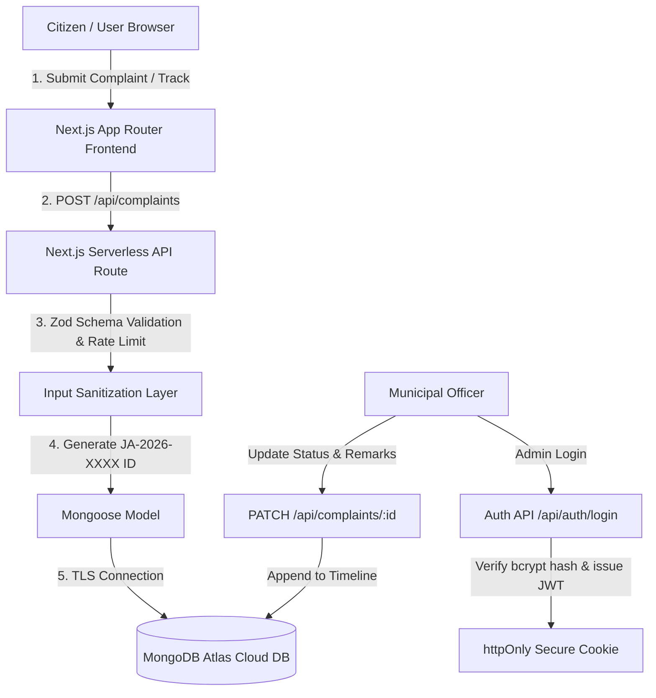

# 🏛️ Jan Awaz Portal (જન અવાજ પોર્ટલ)
### *Citizen Public Grievance Redressal & Municipal Voice Portal*

[](https://nextjs.org/)
[](https://www.typescriptlang.org/)
[](https://www.mongodb.com/atlas)
[](https://tailwindcss.com/)
[](https://vercel.com/)

---

## 📌 1. Project Overview & Problem Statement

### 🎯 The Challenge
In many municipalities and local civic administration bodies, public grievances—such as dangerous road potholes, broken water supply mains, streetlights failing at night, or overflowing garbage containers—frequently go unresolved because:
1. Citizens lack a single, transparent digital window to report issues with photographic evidence.
2. Written petitions or phone calls get lost without an accountable tracking token.
3. Citizens are left in the dark about which department or field officer is working on their complaint.

### 💡 The Jan Awaz Solution
**Jan Awaz Portal** (*Voice of the People*) is a cloud-native, responsive civic grievance redressal portal. Citizens can lodge complaints across 7 key departments, receive an instant, unique Complaint Tracking ID (e.g., `JA-2026-0001`), and track real-time resolution updates. Designated municipal officers can log in securely to inspect evidence, change statuses (`Pending` ➔ `In Progress` ➔ `Resolved` / `Rejected`), and append official audit remarks.

---

## ✨ 2. Features

### 👤 Citizen Features
- **Civic Home Page**: Clear portal introduction, live statistical counters (Total, Pending, In Progress, Resolved grievances), resolution percentage, and fast category shortcuts.
- **Lodge Grievance Form**:
  - Name, Email, Phone number
  - Category selector: **Roads**, **Water**, **Electricity**, **Sanitation**, **Education**, **Health**, **Other**
  - Specific location / ward / landmark input
  - Title & detailed issue description
  - Optional site evidence photo upload (size and file type validated)
  - Instant Complaint ID generation modal with one-click copy to clipboard.
- **Real-Time Grievance Tracker**:
  - Enter Complaint ID (`JA-2026-XXXX`) to view live stage.
  - View full grievance details and attached evidence photo.
  - Chronological **Resolution History Timeline** showing step-by-step progress, timestamps, and officer action notes.
- **Citizen Account (Optional)**:
  - Register and sign in with email and password (hashed with bcrypt).
  - Dedicated **"My Grievances"** dashboard showing all complaints lodged by the citizen.

### 🛡️ Municipal Admin Features (Protected)
- **Secure Authentication**:
  - Admin login protected by JSON Web Tokens (JWT) stored in secure `httpOnly` cookies.
  - Zero password leaks: passwords salted and hashed using `bcryptjs`.
- **Command & Analytics Dashboard**:
  - Top KPI cards: Total, Pending, In Progress, Resolved, Rejected.
  - Interactive **Department Grievance Distribution Chart** visualising load across civic sectors.
  - Live feed of incoming recent grievances.
- **Complaints Registry Management**:
  - Real-time search across Complaint ID, citizen name, email, title, and location.
  - Multi-criteria filtering by Department Category, Status, and Date Range.
  - Server-side pagination and sort order (Newest / Oldest first).
- **Complaint Detail & Status Updater**:
  - Review citizen contact details and attached photo evidence.
  - Change status (`Pending`, `In Progress`, `Resolved`, `Rejected`).
  - Add official inspection notes/remarks that are automatically appended to the public audit timeline.
- **Database Seeder**:
  - Automated seed script populating default admin credentials and realistic demo complaints.

---

## 🛠️ 3. Tech Stack & Architectural Justification

| Layer | Technology | Reason for Selection |
| :--- | :--- | :--- |
| **Framework** | **Next.js 16 (App Router)** | Full-stack React framework providing serverless API routes, Server Components for fast page loads, and native Vercel integration. |
| **Language** | **TypeScript** | Type safety across Mongoose schemas, API contracts, and UI components; eliminates runtime errors and facilitates viva explanation. |
| **Styling** | **Tailwind CSS v4** | Clean, responsive civic UI with dark/light themes, accessible micro-interactions, and fast load times. |
| **Database** | **MongoDB Atlas (Free Tier M0)** | Fully managed NoSQL cloud database running 24x7. Stores dynamic timeline arrays without complex relational joins. |
| **ORM / ODM** | **Mongoose** | Provides strict schema validation, type hooks, auto-generation of Complaint IDs, and query sanitization. |
| **Security** | **JWT + bcryptjs + Zod** | Stateless authentication via httpOnly cookies; cryptographic password hashing; strict input validation preventing XSS and NoSQL injection. |
| **Hosting** | **Vercel** | Free serverless platform running 24x7 without sleeping. Does not require the student's PC to stay turned on. |

---

## 🏗️ 4. System Architecture & Data Flow



---

## 📂 5. Folder Structure

```
jan-awaz-portal/
├── public/                 # Static assets & icons
├── scripts/
│   └── seed.ts             # Database seeder (admin & sample grievances)
├── src/
│   ├── app/                # Next.js App Router (Pages & APIs)
│   │   ├── about/          # About portal & student attribution
│   │   ├── admin/
│   │   │   ├── complaints/ # Complaint list table & detail updater
│   │   │   │   └── [id]/   # Single complaint inspection & status change
│   │   │   ├── dashboard/  # Admin command KPIs & distribution charts
│   │   │   └── login/      # Secure officer authentication
│   │   ├── api/
│   │   │   ├── auth/       # login, register, logout, me routes
│   │   │   ├── complaints/ # GET, POST, [id] PATCH, my routes
│   │   │   └── stats/      # Live KPI metrics and category breakdown
│   │   ├── login/          # Citizen login page
│   │   ├── register/       # Citizen signup page
│   │   ├── my-complaints/  # Citizen grievance dashboard
│   │   ├── submit/         # Public grievance submission form
│   │   ├── track/          # Public status tracking by Complaint ID
│   │   ├── layout.tsx      # Root layout with SEO and fonts
│   │   ├── page.tsx        # Public homepage
│   │   └── globals.css     # Global styles & Tailwind tokens
│   ├── components/         # Reusable UI components
│   │   ├── Navbar.tsx      # Responsive header with dynamic auth pill
│   │   ├── Footer.tsx      # Academic attribution & emergency helplines
│   │   ├── StatusBadge.tsx # Status pill (Pending, In Progress, Resolved)
│   │   ├── CategoryBadge.tsx # Civic category tags with icons
│   │   ├── Timeline.tsx    # Chronological resolution history
│   │   └── CategoryChart.tsx # Visual progress distribution bars
│   ├── lib/                # Shared utilities
│   │   ├── db.ts           # Cached Mongoose connection
│   │   ├── auth.ts         # JWT sign/verify, bcrypt hash, cookies
│   │   ├── validators.ts   # Zod validation schemas & XSS sanitizer
│   │   └── rate-limit.ts   # In-memory sliding window rate limiter
│   └── models/             # Mongoose database models
│       ├── Complaint.ts    # Complaint schema with timeline array
│       └── User.ts         # Admin and citizen accounts schema
├── .env.example            # Environment variables template
├── .gitignore              # Git ignore rules (secrets protected)
├── package.json            # Dependencies & npm scripts
├── tsconfig.json           # TypeScript configuration
└── README.md               # Project documentation
```

---

## 🗄️ 6. Database Collections & Fields

### Collection: `users`
| Field | Type | Description |
| :--- | :--- | :--- |
| `_id` | ObjectId | Unique identifier |
| `name` | String | Full name of citizen or officer |
| `email` | String | Unique email address (indexed, lowercase) |
| `password` | String | Salted bcrypt hash (hidden from default queries) |
| `role` | String | `"admin"` or `"citizen"` (default: `"citizen"`) |
| `phone` | String | Optional telephone contact |
| `createdAt` | Date | Account creation timestamp |

### Collection: `complaints`
| Field | Type | Description |
| :--- | :--- | :--- |
| `_id` | ObjectId | Primary key |
| `complaintId`| String | Unique tracking code, e.g. `JA-2026-0001` (indexed) |
| `name` | String | Citizen full name |
| `email` | String | Citizen email address |
| `phone` | String | Citizen phone number |
| `category` | String | Enum: `Roads`, `Water`, `Electricity`, `Sanitation`, `Education`, `Health`, `Other` |
| `title` | String | Grievance headline |
| `description`| String | Detailed issue narrative |
| `location` | String | Physical ward / area / landmark |
| `imageUrl` | String | Optional base64 or URL of site photo |
| `status` | String | Enum: `Pending`, `In Progress`, `Resolved`, `Rejected` |
| `remarks` | String | Latest officer action remark |
| `timeline` | Array | Array of updates: `[{ status, message, updatedBy, timestamp }]` |
| `userId` | ObjectId | Optional reference to citizen account in `users` |
| `createdAt` | Date | Lodged date and time |

---

## 🌐 7. API Endpoints

| Method | Endpoint | Access | Purpose |
| :--- | :--- | :--- | :--- |
| `POST` | `/api/auth/login` | Public | Authenticates admin/citizen, sets httpOnly cookie |
| `POST` | `/api/auth/register` | Public | Registers a new citizen account |
| `POST` | `/api/auth/logout` | Public | Clears authentication session cookie |
| `GET` | `/api/auth/me` | Public | Returns current authenticated user payload |
| `GET` | `/api/complaints` | Public | Fetches complaints with search, category, status, and pagination |
| `POST` | `/api/complaints` | Public | Lodges a new grievance and generates `JA-2026-XXXX` |
| `GET` | `/api/complaints/[id]` | Public | Retrieves single complaint by ObjectId or Complaint ID |
| `PATCH`| `/api/complaints/[id]` | Admin | Updates status and appends remark to audit timeline |
| `GET` | `/api/complaints/my` | Citizen | Retrieves complaints lodged by current logged-in citizen |
| `GET` | `/api/stats` | Public | Returns aggregate statistics and department distribution |

---

## ⚙️ 8. Step-by-Step Local Setup

### Prerequisites
- **Node.js** (v18 or v20+ LTS recommended)
- **Git**
- A free **MongoDB Atlas** cluster connection string (or local MongoDB)

### Instructions
1. **Clone or navigate to the repository**:
   ```bash
   cd project.2026
   ```

2. **Install dependencies**:
   ```bash
   npm install
   ```

3. **Configure Environment Variables**:
   Copy `.env.example` to `.env.local`:
   ```bash
   cp .env.example .env.local
   ```
   Open `.env.local` and configure your MongoDB URI and secrets:
   ```env
   MONGODB_URI=mongodb+srv://<username>:<password>@cluster0.mongodb.net/jan_awaz_db?retryWrites=true&w=majority
   JWT_SECRET=your_jwt_secret_key_polytechnic_2026
   DEFAULT_ADMIN_NAME=Chief Grievance Officer
   DEFAULT_ADMIN_EMAIL=admin@janawaz.gov.in
   DEFAULT_ADMIN_PASSWORD=Admin@JanAwaz2026
   NEXT_PUBLIC_APP_URL=http://localhost:3000
   ```

4. **Seed the Database**:
   Populate the database with the default admin and sample complaints:
   ```bash
   npm run seed
   ```

5. **Start Development Server**:
   ```bash
   npm run dev
   ```
   Open [http://localhost:3000](http://localhost:3000) in your web browser.

---

## 🔑 9. Default Demo Credentials

| Role | Email | Password | Access Area |
| :--- | :--- | :--- | :--- |
| **Municipal Admin** | `admin@janawaz.gov.in` | `Admin@JanAwaz2026` | `/admin/login` & `/admin/dashboard` |
| **Citizen Demo** | `citizen@janawaz.gov.in`| `Citizen@123` | `/login` & `/my-complaints` |

---

## 🚀 10. Deployment Guide (Vercel + MongoDB Atlas 24x7)

### Step 1: MongoDB Atlas Setup (Free M0 Cluster)
1. Sign up at [mongodb.com/atlas](https://www.mongodb.com/atlas).
2. Create a free **M0 Sandbox** cluster (e.g., in AWS Mumbai / `ap-south-1` region for fastest India latency).
3. Under **Database Access**, create a user (e.g., `janawaz_admin`) with a secure password.
4. Under **Network Access**, click **Add IP Address** and choose **Allow Access From Anywhere** (`0.0.0.0/0`). This is mandatory so Vercel serverless functions can connect.
5. In **Clusters** > **Connect** > **Drivers**, copy the connection string. Replace `<password>` with your user password.

### Step 2: Push Code to GitHub
1. Initialize git and commit:
   ```bash
   git init
   git add .
   git commit -m "Initial commit: Jan Awaz Portal for Bhavsinhji Polytechnic"
   ```
2. Create a new repository on your GitHub account (e.g., `jan-awaz-portal`).
3. Push your code:
   ```bash
   git remote add origin https://github.com/<your-username>/jan-awaz-portal.git
   git branch -M main
   git push -u origin main
   ```

### Step 3: Deploy to Vercel
1. Sign in to [vercel.com](https://vercel.com) using your GitHub account.
2. Click **Add New...** ➔ **Project** and import your `jan-awaz-portal` repository.
3. Under **Environment Variables**, add the keys from your `.env.local`:
   - `MONGODB_URI`
   - `JWT_SECRET`
   - `DEFAULT_ADMIN_NAME`
   - `DEFAULT_ADMIN_EMAIL`
   - `DEFAULT_ADMIN_PASSWORD`
   - `NEXT_PUBLIC_APP_URL`
4. Click **Deploy**. Vercel will build and launch your portal on a 24x7 live URL (e.g., `https://jan-awaz-portal.vercel.app`).
5. Run the seed script locally against the Atlas URI once so initial demo data is present:
   ```bash
   npm run seed
   ```

---

## 🔗 11. Live Production Deployment

- **Live URL**: `[Pending Deployment in Phase 2]`
- **GitHub Repository**: `[Pending GitHub Push in Phase 2]`

---

## 🔮 12. Future Scope
- **Automated WhatsApp / SMS Alert Gateway**: Send automated SMS with Complaint ID and status notifications to citizens.
- **GIS Heatmap & Geofencing**: Display a public interactive heatmap of recurring municipal problems across wards.
- **AI-Powered Duplicate Detection**: Automatically identify if another citizen has already lodged a grievance for the same pothole or water leak.
- **Multilingual Support (Gujarati & Hindi)**: Full localization for Gujarati (ગુજરાતી) and Hindi to maximize grassroots adoption.

---

## 👨‍🎓 13. Author & Academic Information

- **Student Author**: Diploma in Information Technology (5th Semester)
- **Institution**: **Sir Bhavsinhji Polytechnic Institute of Technology**, Bhavnagar, Gujarat
- **Department**: Department of Information Technology
- **Academic Year**: 2026
- **Project Title**: Jan Awaz Portal (Public Grievance Redressal System)

---
*Developed with pride for academic excellence and citizen empowerment.*
