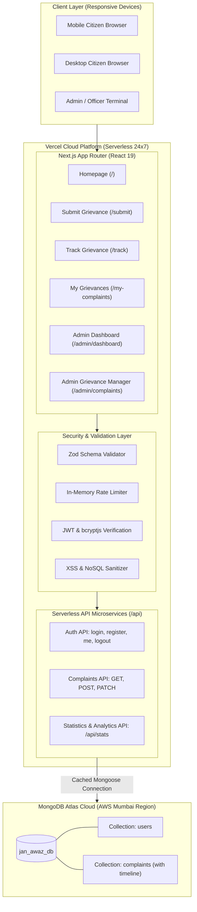
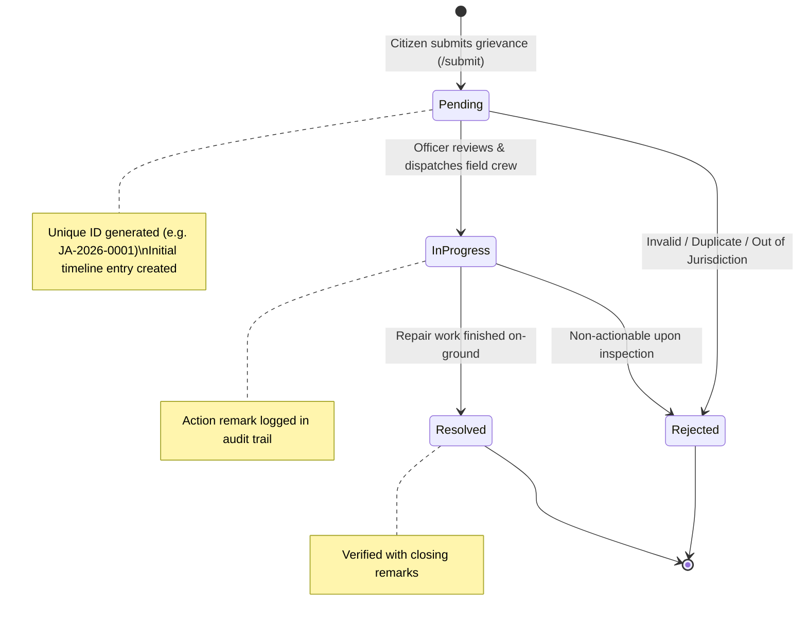
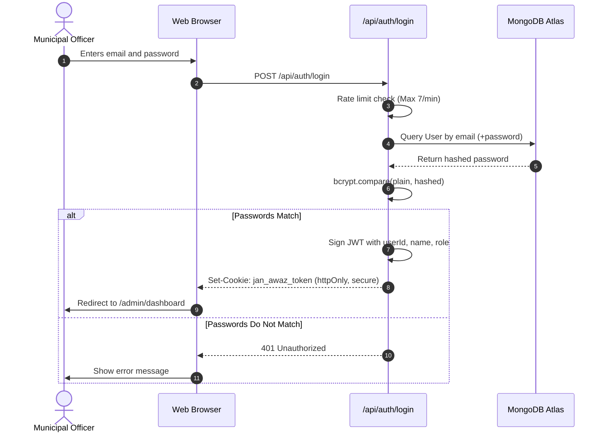

# 🏛️ Jan Awaz Portal Architecture & Diagrams
### *Sir Bhavsinhji Polytechnic Institute of Technology*

## 1. System Architecture Diagram

---

## 2. Complaint Lifecycle State Transition Diagram

---

## 3. Authentication & JWT Cookie Flow

